# PanicDrop — Comprehensive Architecture & System Design Specification

This document provides a complete technical analysis and architectural blueprint for **PanicDrop: AI-Driven E-Commerce & Predictive Inventory Ecosystem**. It includes formal system models, workflows, UML diagrams, data schemas, wireframes, technology stack matrices, and API specifications designed for enterprise scalability and Indian retail localization.

---

## Table of Contents
- [1. System Overview](#1-system-overview)
- [2. Section 3.1: System Architecture](#2-section-31-system-architecture)
  - [2.1 High-Level Architecture Diagram](#21-high-level-architecture-diagram)
  - [2.2 Multi-Tier Architectural Breakdown](#22-multi-tier-architectural-breakdown)
  - [2.3 Hybrid Persistence Proxy Pattern](#23-hybrid-persistence-proxy-pattern)
- [3. Section 3.2: System Workflow](#3-section-32-system-workflow)
  - [3.1 Customer Shopping & Checkout Workflow](#31-customer-shopping--checkout-workflow)
  - [3.2 User Authentication & Role Guard Workflow](#32-user-authentication--role-guard-workflow)
  - [3.3 Admin Real-Time Inventory & Restocking Workflow](#33-admin-real-time-inventory--restocking-workflow)
  - [3.4 Order State Machine Lifecycle](#34-order-state-machine-lifecycle)
- [4. Section 3.3: UML Diagrams](#4-section-33-uml-diagrams)
  - [4.1 UML Use Case Diagram](#41-uml-use-case-diagram)
  - [4.2 UML Class Diagram](#42-uml-class-diagram)
  - [4.3 UML Sequence Diagram: Order Checkout & Stock Adjustment](#43-uml-sequence-diagram-order-checkout--stock-adjustment)
  - [4.4 UML Sequence Diagram: Catalog Query & Faceted Filter](#44-uml-sequence-diagram-catalog-query--faceted-filter)
  - [4.5 UML Activity Diagram: Checkout & Payment Validation](#45-uml-activity-diagram-checkout--payment-validation)
- [5. Section 3.4: Database & Data Design](#5-section-34-database--data-design)
  - [5.1 Entity-Relationship (ER) Diagram](#51-entity-relationship-er-diagram)
  - [5.2 Data Dictionary & Schema Specifications](#52-data-dictionary--schema-specifications)
  - [5.3 Indexing & Performance Strategy](#53-indexing--performance-strategy)
- [6. Section 3.5: Interface & Wireframes](#6-section-35-interface--wireframes)
  - [6.1 Application Navigation Map](#61-application-navigation-map)
  - [6.2 Wireframe 1: Storefront Landing Page](#62-wireframe-1-storefront-landing-page)
  - [6.3 Wireframe 2: High-Performance Catalog with Faceted Search](#63-wireframe-2-high-performance-catalog-with-faceted-search)
  - [6.4 Wireframe 3: Product Detail Page (PDP)](#64-wireframe-3-product-detail-page-pdp)
  - [6.5 Wireframe 4: Express Indian Checkout Page](#65-wireframe-4-express-indian-checkout-page)
  - [6.6 Wireframe 5: Admin Intelligence & Operations Dashboard](#66-wireframe-5-admin-intelligence--operations-dashboard)
- [7. Section 3.6: Technology Stack and Tools](#7-section-36-technology-stack-and-tools)
  - [7.1 Tech Stack Architecture Diagram](#71-tech-stack-architecture-diagram)
  - [7.2 Technology Matrix & Justification](#72-technology-matrix--justification)
  - [7.3 Tooling & Infrastructure](#73-tooling--infrastructure)
- [8. Section 3.7: API & Component Design](#8-section-37-api--component-design)
  - [8.1 Frontend Component Hierarchy](#81-frontend-component-hierarchy)
  - [8.2 Client State Management Architecture](#82-client-state-management-architecture)
  - [8.3 Backend RESTful API Endpoint Reference](#83-backend-restful-api-endpoint-reference)
  - [8.4 Express Request Middleware Pipeline](#84-express-request-middleware-pipeline)

---

## 1. System Overview

**PanicDrop** is a modern, full-stack, AI-informed e-commerce and predictive inventory platform engineered specifically for the Indian digital retail marketplace. The system features:
- **10,000+ Item Catalog**: Synthesized from Flipkart retail datasets spanning 6 high-demand consumer departments.
- **Indian Market Localization**: Built-in support for Indian Rupee (`₹` INR) formatting, 6-digit PIN Code delivery validation, Indian address models, and native payment preferences (UPI, Cash on Delivery, NetBanking).
- **Sub-15ms Catalog Search**: In-memory query indexing and compound Mongoose query optimization across 417+ paginated catalog views.
- **Dual-Mode Persistence Architecture**: Dynamic ES6 Proxy fallback that toggles between cloud MongoDB and an embedded in-memory memory server, guaranteeing zero downtime.
- **Executive Operations & Predictive Analytics**: Interactive admin controls with real-time KPI aggregations, demand forecasting heuristics, and inventory stock velocity monitoring.

---

## 2. Section 3.1: System Architecture

The PanicDrop system implements a **Decoupled Multi-Tier Architecture** consisting of an SPA Client Tier, an API Gateway & Routing Tier, a Business Logic & Controller Tier, and an Abstracted Persistence Tier.

### 2.1 High-Level Architecture Diagram

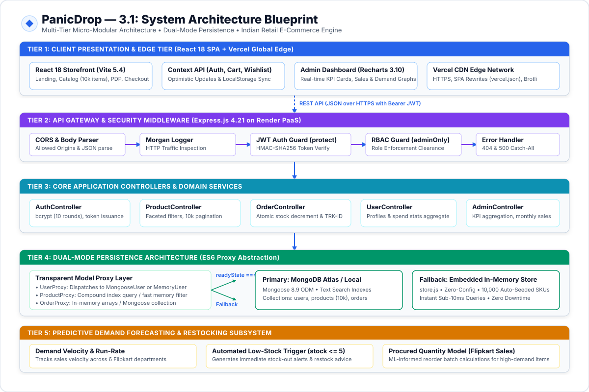

<details>
<summary>▶ Click to expand Mermaid code specification</summary>

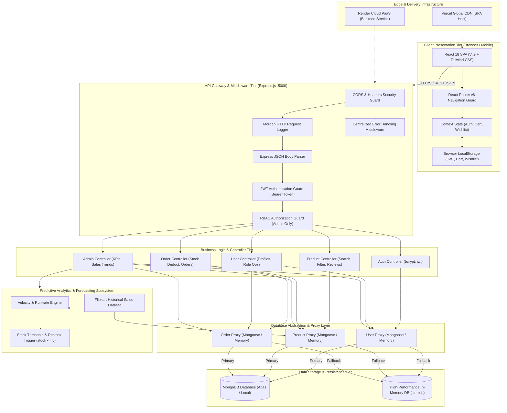
</details>

### 2.2 Multi-Tier Architectural Breakdown

| Tier | Component | Responsibilities & Architectural Function |
| :--- | :--- | :--- |
| **Presentation Tier** | React 18, Vite, Tailwind CSS, Lucide Icons | Responsive single-page application (SPA); client-side routing; optimistic UI updates for cart/wishlist; dynamic data visualization via Recharts. |
| **Client State Tier** | React Context API (`AuthContext`, `CartContext`, `WishlistContext`) | Centralized state management with bidirectional synchronization to browser `localStorage` for offline session and basket persistence. |
| **API & Routing Tier** | Express 4.x, CORS, Morgan | HTTP endpoint exposure; JSON request/response parsing; request logging; centralized exception handling and custom 404 router fallbacks. |
| **Security & Auth Tier** | JWT (`jsonwebtoken`), `bcryptjs` | Bearer token validation, stateless request authentication, role-based access control (`customer` vs `admin`), and one-way password hashing (10 salt rounds). |
| **Application Services** | Controllers (`auth`, `product`, `order`, `user`, `admin`) | Domain logic execution: multi-faceted product searching and filtering, inventory atomic decrementing, INR price calculation, and KPI aggregation. |
| **Data Persistence Tier** | MongoDB Mongoose ODM + Embedded In-Memory Store | Document storage with schema enforcement, compound query indexing, pre-save slug hooks, and zero-configuration auto-fallback to memory storage. |
| **Analytics Subsystem** | Recharts, Admin Controller Metrics | Revenue summation, order status distribution, sales velocity tracking, and stock-out prevention heuristics. |

### 2.3 Hybrid Persistence Proxy Pattern

To ensure seamless operation during development, cloud demonstrations, and production deployments without hard database dependencies, PanicDrop introduces an **ES6 Transparent Proxy Database Abstraction Layer**:

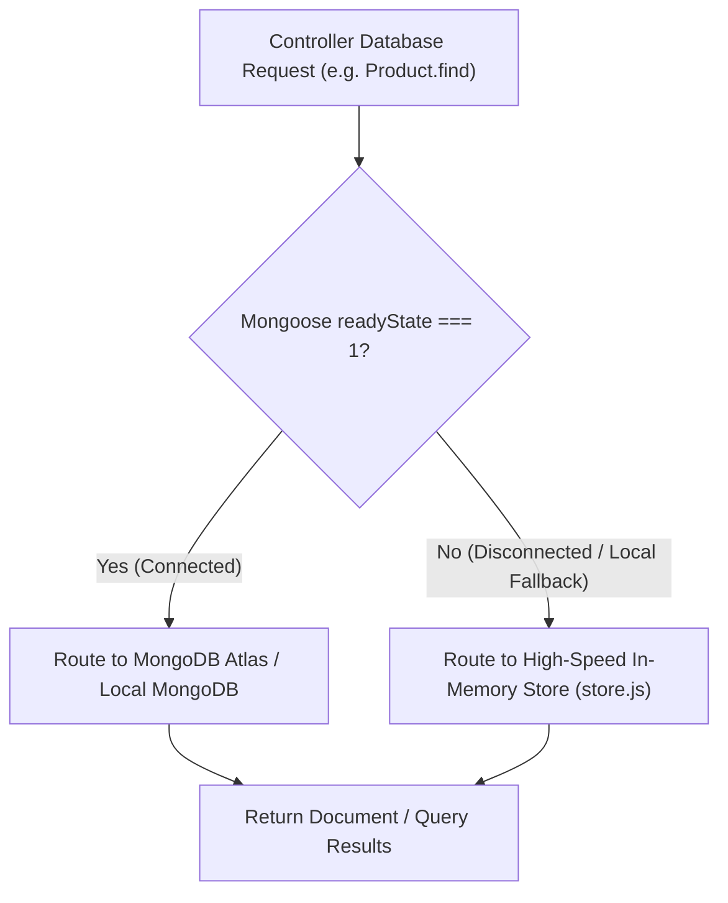

This pattern wraps `MongooseProduct`, `MongooseUser`, and `MongooseOrder` within dynamic JavaScript `Proxy` objects:
- When a live MongoDB connection is detected (`mongoose.connection.readyState === 1`), queries are routed directly through Mongoose.
- If the database connection drops or is unconfigured, calls seamlessly route to `MemoryUser`, `MemoryProduct`, and `MemoryOrder` in `store.js` without requiring changes to controller business logic.

---

## 3. Section 3.2: System Workflow

This section outlines the primary business workflows and state transitions across customer shopping, authentication, and inventory administration.

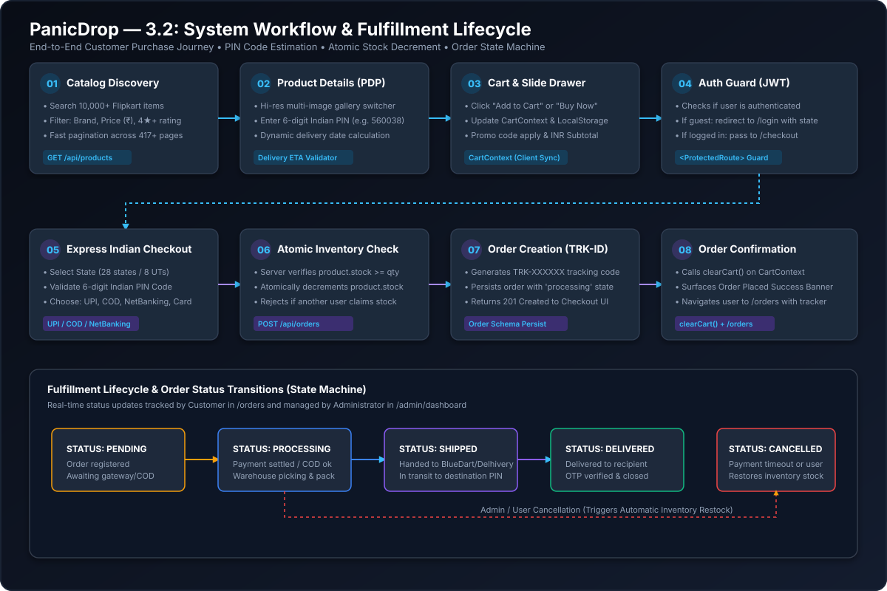

### 3.1 Customer Shopping & Checkout Workflow

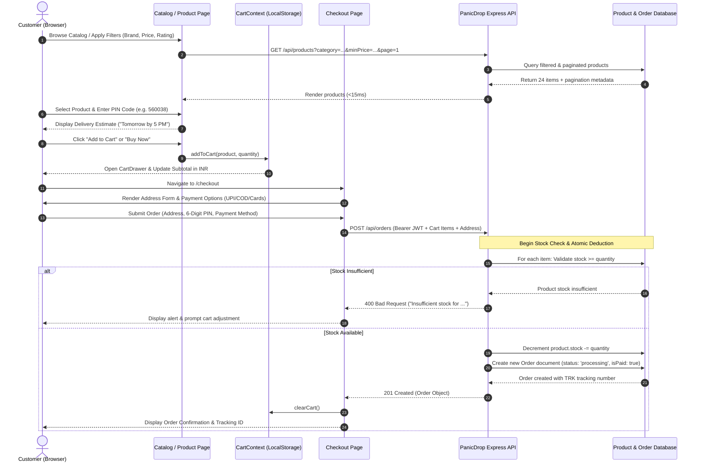

### 3.2 User Authentication & Role Guard Workflow

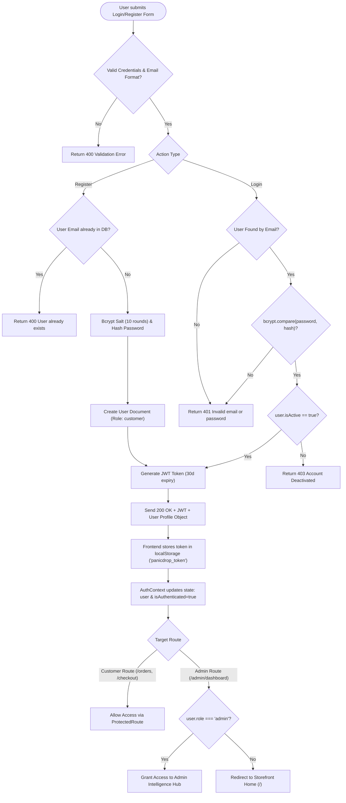

### 3.3 Admin Real-Time Inventory & Restocking Workflow

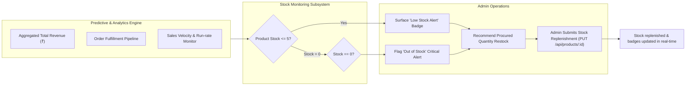

### 3.4 Order State Machine Lifecycle

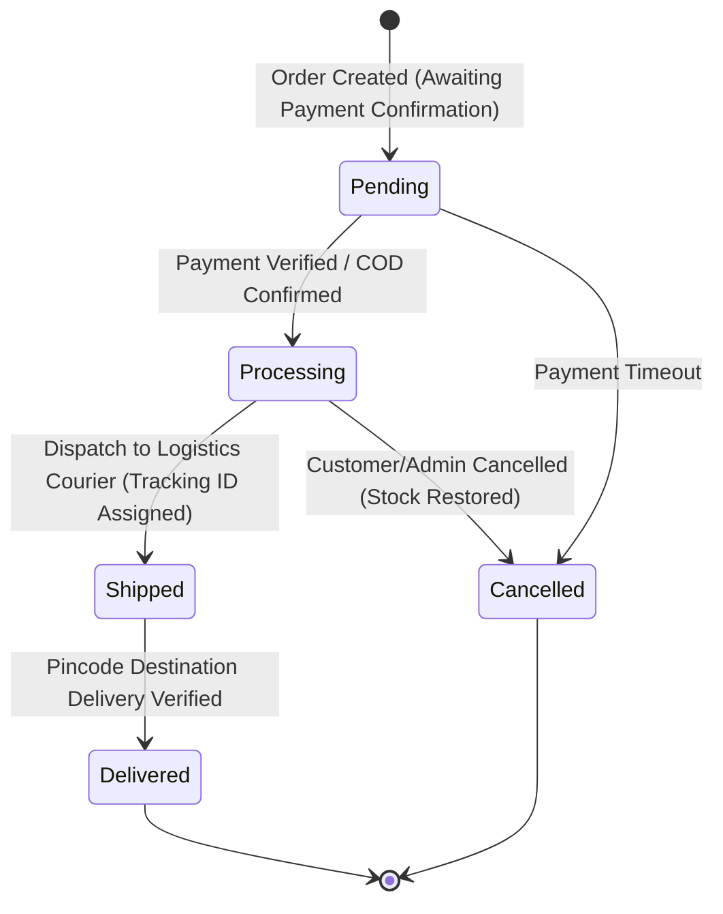

---

## 4. Section 3.3: UML Diagrams

This section contains formal Unified Modeling Language (UML) specifications representing actors, domain entities, interactions, and activities.

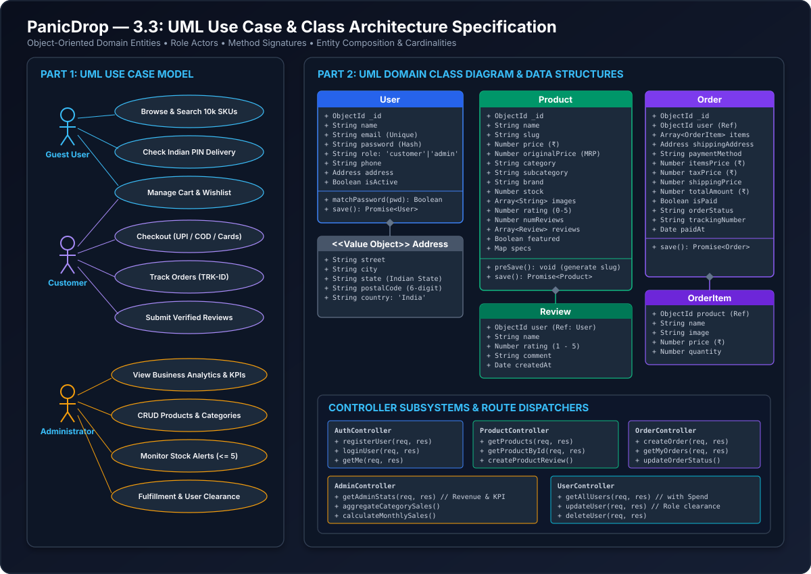

### 4.1 UML Use Case Diagram

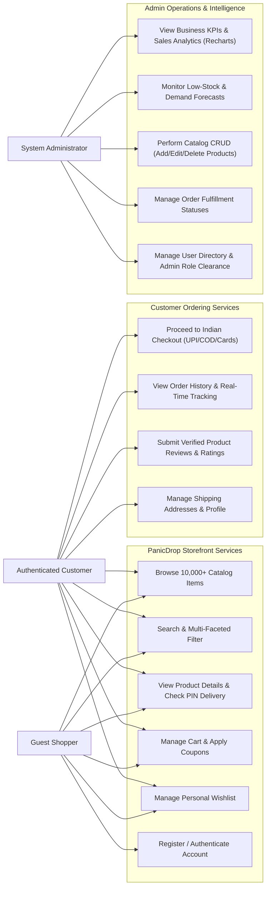

### 4.2 UML Class Diagram

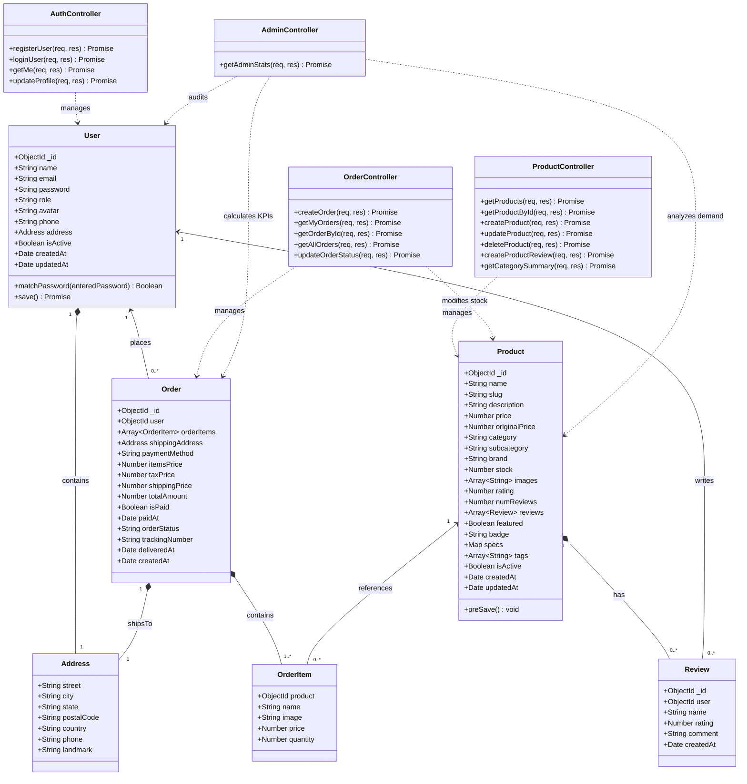

### 4.3 UML Sequence Diagram: Order Checkout & Stock Adjustment

```mermaid
sequenceDiagram
    autonumber
    actor Customer
    participant CheckoutPage as Checkout Page
    participant ApiClient as api.orders Service
    participant AuthMiddleware as authMiddleware (JWT Protect)
    participant OrderCtrl as OrderController
    participant ProductModel as Product Proxy
    participant OrderModel as Order Proxy

    Customer->>CheckoutPage: Click "Place Order" (₹ Total)
    CheckoutPage->>ApiClient: api.orders.create(orderPayload)
    ApiClient->>AuthMiddleware: POST /api/orders (Authorization: Bearer <token>)
    AuthMiddleware->>AuthMiddleware: Verify JWT signature & decode user._id
    AuthMiddleware->>OrderCtrl: Invoke createOrder(req, res)

    loop For every item in orderItems
        OrderCtrl->>ProductModel: findById(item.product)
        ProductModel-->>OrderCtrl: product record
        OrderCtrl->>OrderCtrl: Verify product.stock >= item.quantity
        OrderCtrl->>ProductModel: product.stock -= item.quantity; product.save()
        ProductModel-->>OrderCtrl: Updated Product (Inventory decremented)
    end

    OrderCtrl->>OrderModel: new Order({ user, orderItems, shippingAddress, totalAmount... }).save()
    OrderModel-->>OrderCtrl: Saved Order with auto-generated trackingNumber
    OrderCtrl-->>ApiClient: 201 Created { success: true, order: {...} }
    ApiClient-->>CheckoutPage: Order Success Object
    CheckoutPage->>Customer: Display Order Confirmation with Tracking Number
```

### 4.4 UML Sequence Diagram: Catalog Query & Faceted Filter

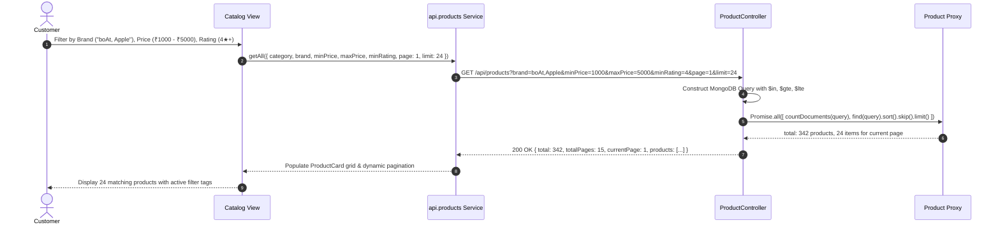

### 4.5 UML Activity Diagram: Checkout & Payment Validation

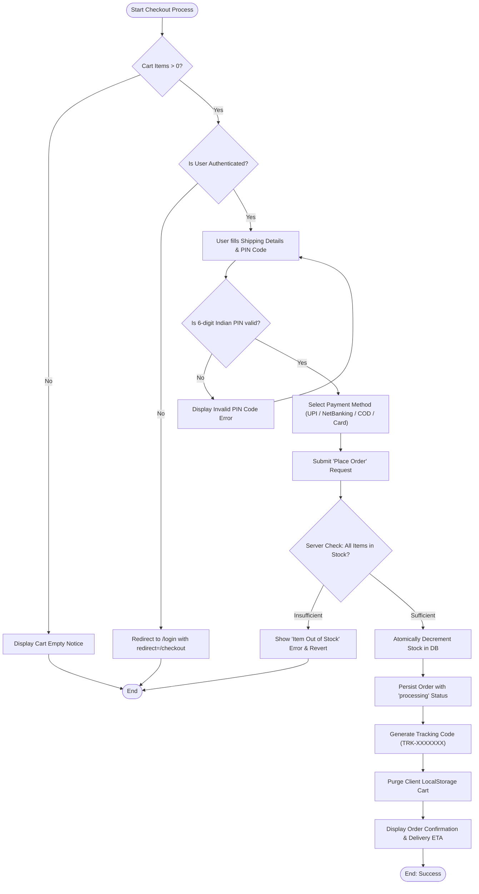

---

## 5. Section 3.4: Database & Data Design

PanicDrop is engineered with a schema structure centered on high-throughput e-commerce operations, support for thousands of SKUs, and Indian address data structures.

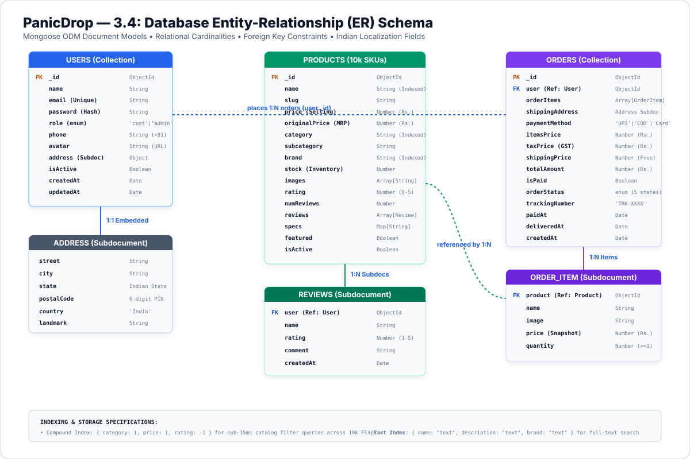

### 5.1 Entity-Relationship (ER) Diagram

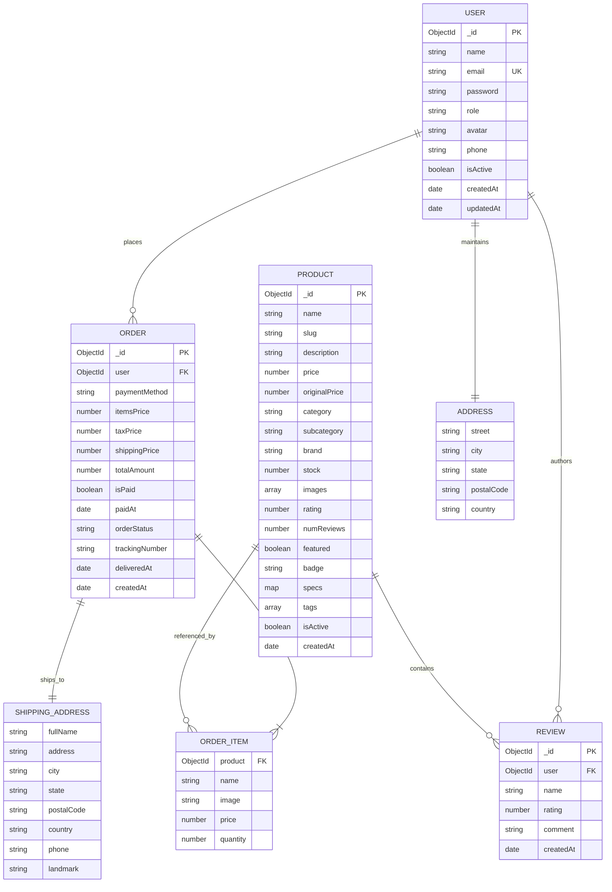

### 5.2 Data Dictionary & Schema Specifications

#### 5.2.1 `User` Entity Schema
| Field | Type | Required | Constraints / Defaults | Description |
| :--- | :--- | :---: | :--- | :--- |
| `_id` | ObjectId | Yes | Unique Primary Key | User record identifier |
| `name` | String | Yes | Trimmed | Full customer or administrator name |
| `email` | String | Yes | Unique, Lowercase, Indexed | Login email address |
| `password` | String | Yes | Min 6 chars, Select: false | 1-way Bcrypt password hash (10 salt rounds) |
| `role` | String | Yes | `enum: ['customer', 'admin']`, Default: `'customer'` | Role-based authorization clearance level |
| `avatar` | String | No | Default Unsplash URL | User display profile avatar URL |
| `phone` | String | No | Default: `''` | Mobile number for delivery updates |
| `address` | Object | No | Nested Subdocument | Street, city, state, postalCode, country |
| `isActive` | Boolean| Yes | Default: `true` | Account active / deactivated status flag |
| `createdAt`| Date | Auto | Timestamps: `true` | Account registration timestamp |

#### 5.2.2 `Product` Entity Schema
| Field | Type | Required | Constraints / Defaults | Description |
| :--- | :--- | :---: | :--- | :--- |
| `_id` | ObjectId | Yes | Unique Primary Key | Product SKU identifier |
| `name` | String | Yes | Trimmed, Indexed | Product title / model name |
| `slug` | String | Auto | Lowercase, Hyphenated | SEO-friendly URL slug (auto-generated) |
| `description`| String | Yes | Full text | Detailed specification and marketing copy |
| `price` | Number | Yes | Min: `0`, Indexed | Current discounted Indian selling price (`₹`) |
| `originalPrice`| Number| No | Min: `0`, Default: `0` | MRP / sticker price before discount (`₹`) |
| `category` | String | Yes | Indexed | Top-level category (e.g. `Mobiles & Accessories`) |
| `subcategory`| String| No | Default: `'General'` | Secondary subcategory (e.g. `Smartphones`) |
| `brand` | String | Yes | Indexed | Brand name (e.g. `Apple`, `boAt`, `Samsung`) |
| `stock` | Number | Yes | Min: `0`, Default: `10` | Physical stock count available in inventory |
| `images` | Array[String]| Yes| Min length 1 | Array of CDN-hosted product gallery images |
| `rating` | Number | No | Min: `0`, Max: `5`, Default: `4.8` | Cumulative average customer rating |
| `numReviews` | Number | No | Default: `0` | Total verified customer reviews submitted |
| `reviews` | Array[Review]| No| Subdocument Array | Nested array of `reviewSchema` objects |
| `featured` | Boolean| No | Default: `false` | Homepage showcase banner flag |
| `badge` | String | No | Default: `''` | UI tag (e.g. `'HOT'`, `'TOP DEAL'`, `'NEW'`) |
| `specs` | Map[String]| No| Key-Value pairs | Technical specifications (RAM, Battery, etc.) |
| `tags` | Array[String]| No| Indexed | Keyword tags for elastic search queries |
| `isActive` | Boolean| Yes | Default: `true` | Catalog availability toggle |

#### 5.2.3 `Order` Entity Schema
| Field | Type | Required | Constraints / Defaults | Description |
| :--- | :--- | :---: | :--- | :--- |
| `_id` | ObjectId | Yes | Unique Primary Key | Order record identifier |
| `user` | ObjectId | Yes | Ref: `'User'`, Indexed | Associated customer account |
| `orderItems` | Array | Yes | Non-empty subdocuments | Snapshot of products, price, quantity ordered |
| `shippingAddress`| Object | Yes | Structured Indian Address | Full recipient address, city, state, PIN code |
| `paymentMethod`| String | Yes | Default: `'Credit Card'` | Payment channel (UPI, NetBanking, COD) |
| `itemsPrice` | Number | Yes | Min: `0.0` | Net sum of products before tax/shipping |
| `taxPrice` | Number | Yes | Default: `0.0` | GST / tax component in INR |
| `shippingPrice`| Number | Yes | Default: `0.0` (Free for ₹500+) | Logistics handling charge |
| `totalAmount` | Number | Yes | Min: `0.0` | Final transaction amount charged |
| `isPaid` | Boolean| Yes | Default: `true` | Payment completion confirmation |
| `paidAt` | Date | No | Default: `Date.now` | Payment settlement timestamp |
| `orderStatus` | String | Yes | `enum: ['pending', 'processing', 'shipped', 'delivered', 'cancelled']` | Current fulfillment lifecycle state |
| `trackingNumber`| String | Auto | Unique string | Logistic airway bill / tracking code (`TRK-...`) |
| `deliveredAt` | Date | No | Optional timestamp | Verified physical delivery timestamp |

### 5.3 Indexing & Performance Strategy

To maintain <15ms response latency across the 10,000+ item catalog, PanicDrop implements targeted indexing strategies:

```javascript
// Compound index for category navigation and price-range sorting
productSchema.index({ category: 1, price: 1, rating: -1 });

// Full-text search index for catalog-wide keyword search
productSchema.index({ 
  name: "text", 
  description: "text", 
  brand: "text", 
  tags: "text" 
});

// Single-field indexes for filtering and stock alerts
productSchema.index({ brand: 1 });
productSchema.index({ stock: 1 });
productSchema.index({ isActive: 1 });

// Order lookup indexes for customer order history & admin fulfillment pipelines
orderSchema.index({ user: 1, createdAt: -1 });
orderSchema.index({ orderStatus: 1 });
```

---

## 6. Section 3.5: Interface & Wireframes

This section details the user experience architecture, screen layouts, and wireframes for both customer storefront and administrator operational views.

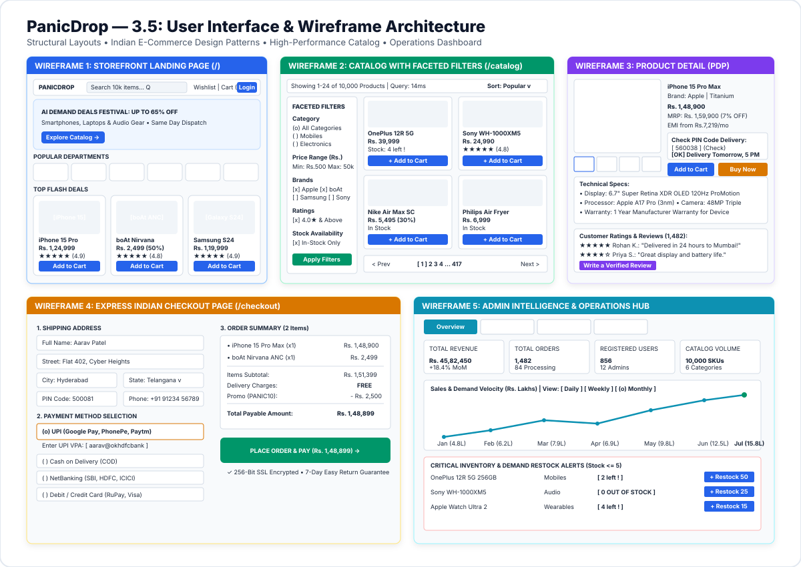

### 6.1 Application Navigation Map

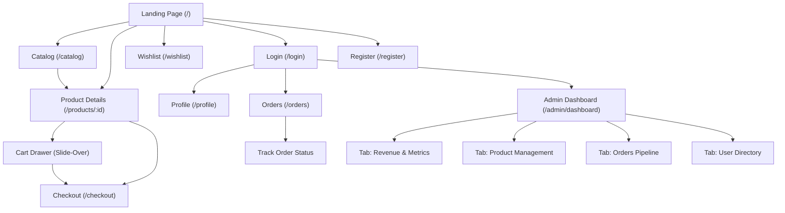

---

### 6.2 Wireframe 1: Storefront Landing Page

```
+----------------------------------------------------------------------------------------------------+
|  [Logo] PANICDROP      [ Search 10,000+ Flipkart deals...   Q ]    Wishlist (3)  Cart (2)  [Sign In]|
+----------------------------------------------------------------------------------------------------+
|  [All Categories]  Mobiles & 5G | Laptops & Audio | Smart Wearables | Fashion | Home & Kitchen     |
+----------------------------------------------------------------------------------------------------+
|                                                                                                    |
|  +----------------------------------------------------------------------------------------------+  |
|  |  HERO BANNER: AI-POWERED DEMAND SAVINGS                                                      |  |
|  |  Mega Indian Electronics Festival: Up to 65% OFF                                            |  |
|  |  Smartphones, Laptops, Audio Gear & Smartwatches with Same-Day Dispatch                      |  |
|  |  [ Explore Catalog Now -> ]             [ View Daily Flash Deals ]                           |  |
|  +----------------------------------------------------------------------------------------------+  |
|                                                                                                    |
|  VALUE BADGES:                                                                                     |
|  [ (Truck) Free Delivery > ₹499 ]  [ (Shield) Genuine Brands ]  [ (Rotate) 7-Day Easy Returns ]   |
|                                                                                                    |
|  FEATURED FLASH DEALS:                                                                             |
|  +---------------------+ +---------------------+ +---------------------+ +---------------------+  |
|  | [HOT DEAL]          | | [SAVE 35%]          | | [BESTSELLER]        | | [LIMITED]           |  |
|  | [Img: iPhone 15 Pro]| | [Img: boAt Nirvana] | | [Img: Galaxy S24]   | | [Img: Noise Watch]  |  |
|  | iPhone 15 Pro 128GB | | boAt Nirvana ANC    | | Samsung S24 Ultra   | | Noise ColorFit Pro  |  |
|  | ₹1,24,999  (₹134k)  | | ₹2,499   (₹4,990)   | | ₹1,19,999  (₹139k)  | | ₹1,799   (₹4,999)   |  |
|  | ★★★★☆ (4.9)         | | ★★★★★ (4.8)         | | ★★★★★ (4.9)         | | ★★★★☆ (4.6)         |  |
|  | [ Add to Cart ]     | | [ Add to Cart ]     | | [ Add to Cart ]     | | [ Add to Cart ]     |  |
|  +---------------------+ +---------------------+ +---------------------+ +---------------------+  |
|                                                                                                    |
+----------------------------------------------------------------------------------------------------+
|  FOOTER: About PanicDrop | 10k SKU Indian Catalog | UPI/COD Supported | © 2026 PanicDrop Ecosystem  |
+----------------------------------------------------------------------------------------------------+
```

---

### 6.3 Wireframe 2: High-Performance Catalog with Faceted Search

```
+----------------------------------------------------------------------------------------------------+
|  PANICDROP > Catalog  |  Showing 1 - 24 of 10,000 Products              Sort by: [ Popularity v ]  |
+-----------------------+----------------------------------------------------------------------------+
| FILTERS               |  CATALOG GRID VIEW                                                         |
|                       |  +----------------------+ +----------------------+ +---------------------+ |
| [x] Clear All Filters |  | [Img: OnePlus 12R]   | | [Img: Sony WH-1000]  | | [Img: MacBook Air]  | |
|                       |  | OnePlus 12R 5G 256GB | | Sony ANC Headphones  | | Apple M3 MacBook Air| |
| Category:             |  | ₹39,999  (₹45,999)   | | ₹19,990  (₹29,990)   | | ₹1,04,900 (₹1,14k)  | |
| (o) All Categories    |  | In Stock (Only 4)    | | In Stock             | | In Stock            | |
| ( ) Mobiles & Acc.    |  | [ Add to Cart ]      | | [ Add to Cart ]      | | [ Add to Cart ]     | |
| ( ) Electronics       |  +----------------------+ +----------------------+ +---------------------+ |
| ( ) Smart Wearables   |  +----------------------+ +----------------------+ +---------------------+ |
| ( ) Fashion & Home    |  | [Img: Nike Air Max]  | | [Img: Philips AirFry]| | [Img: Amazfit GTS]  | |
|                       |  | Nike Air Max SC      | | Philips Digital Fryer| | Amazfit GTS 4 Smart | |
| Price Range (₹):      |  | ₹5,495   (₹7,995)    | | ₹6,999   (₹10,999)   | | ₹7,999   (₹12,999)  | |
| Min: [ 500  ]         |  | In Stock             | | In Stock             | | In Stock            | |
| Max: [ 50000]         |  | [ Add to Cart ]      | | [ Add to Cart ]      | | [ Add to Cart ]     | |
|                       |  +----------------------+ +----------------------+ +---------------------+ |
| Brands:               |                                                                            |
| [x] Apple   [x] boAt  |  PAGINATION:                                                               |
| [ ] Samsung [ ] Sony  |  [ < Previous ]   [ 1 ]  [ 2 ]  [ 3 ] ... [ 417 ]   [ Next > ]             |
| [ ] Asus    [ ] Nike  |  Response Time: 12ms | Indexed Query Optimization                          |
|                       |                                                                            |
| Minimum Rating:       |                                                                            |
| [x] 4.0 Stars & Above |                                                                            |
|                       |                                                                            |
| Availability:         |                                                                            |
| [x] In Stock Only     |                                                                            |
+-----------------------+----------------------------------------------------------------------------+
```

---

### 6.4 Wireframe 3: Product Detail Page (PDP)

```
+----------------------------------------------------------------------------------------------------+
|  Home > Mobiles & Accessories > Smartphones > Apple iPhone 15 Pro Max                              |
+----------------------------------------------------------------------------------------------------+
|  GALLERY VIEW               |  PRODUCT SPECIFICATIONS & PURCHASE CARD                              |
|                             |                                                                      |
|  +-----------------------+  |  Apple iPhone 15 Pro Max (Natural Titanium, 256 GB)                  |
|  |                       |  |  Brand: Apple  |  SKU: PD-APL-15PM-256                                |
|  |                       |  |  ★★★★★ 4.9 (1,482 verified customer ratings)                        |
|  |  MAIN HI-RES IMAGE    |  |                                                                      |
|  |  [ Unsplash CDN ]     |  |  ₹1,48,900  MRP: ₹1,59,900  (Save ₹11,000 / 7% OFF)                  |
|  |                       |  |  Inclusive of all Indian taxes. EMI starts at ₹7,219/month.          |
|  |                       |  |                                                                      |
|  +-----------------------+  |  DELIVERY CHECKER (PIN CODE):                                        |
|  THUMBNAILS:                |  [ 560038        ] [ Check PIN ]                                     |
|  [Img1] [Img2] [Img3] [Img4]|  (Checkmark) Delivery Available: Tomorrow by 5:00 PM to Bengaluru    |
|                             |                                                                      |
|                             |  KEY SPECIFICATIONS:                                                 |
|                             |  - Display: 6.7-inch Super Retina XDR OLED ProMotion 120Hz           |
|                             |  - Chipset: A17 Pro 3nm Processor                                    |
|                             |  - Camera: 48MP Triple Lens with 5x Optical Telephoto                |
|                             |  - Warranty: 1 Year Apple India Warranty                             |
|                             |                                                                      |
|                             |  STOCK STATUS: [ In Stock (23 units remaining) ]                     |
|                             |                                                                      |
|                             |  ACTION BUTTONS:                                                     |
|                             |  [ Qty: 1 v ]   [ + ADD TO CART ]   [ BUY NOW (Express Checkout) ]   |
|                             |  [ <3 Add to Wishlist ]                                              |
+-----------------------------+----------------------------------------------------------------------+
|  VERIFIED REVIEWS (1,482)                                                                          |
|  [ Write a Review: Rating [ 5 Stars v ]  Comment: [ Excellent battery & camera! ]  [ Submit ] ]     |
|  - Rohan K. ★★★★★: "Arrived in 24 hours in Mumbai. Original sealed unit!"                          |
|  - Ananya S. ★★★★☆: "Premium build, super smooth display."                                         |
+----------------------------------------------------------------------------------------------------+
```

---

### 6.5 Wireframe 4: Express Indian Checkout Page

```
+----------------------------------------------------------------------------------------------------+
|  PANICDROP CHECKOUT  |  Secure 256-bit Encrypted SSL Transaction                                    |
+-----------------------------------------------------+----------------------------------------------+
|  1. SHIPPING & DELIVERY ADDRESS                     |  2. ORDER SUMMARY (2 Items)                  |
|                                                     |                                              |
|  Full Name:      [ Aarav Patel                    ] |  - iPhone 15 Pro Max (x1)        ₹1,48,900   |
|  Street Address: [ Flat 402, Cyber Heights        ] |  - boAt Nirvana ANC (x1)            ₹2,499   |
|  City:           [ Hyderabad                      ] |  ------------------------------------------- |
|  State:          [ Telangana                    v ] |  Items Subtotal:                 ₹1,51,399   |
|  6-Digit PIN:    [ 500081                         ] |  Estimated GST (18% included):      ₹0       |
|  Phone (+91):    [ +91 91234 56789                ] |  Delivery Charges:                  FREE     |
|  Landmark:       [ Near Hitec City Cyber Towers   ] |  Coupon Discount (PANIC10):       - ₹2,500   |
|                                                     |  ------------------------------------------- |
|  PAYMENT METHOD SELECTION:                          |  TOTAL PAYABLE AMOUNT:           ₹1,48,899   |
|  (o) UPI (Google Pay / PhonePe / Paytm)             |                                              |
|      UPI ID: [ aarav@okhdfcbank             ]       |  [ PLACE ORDER & PAY NOW (₹1,48,899) -> ]    |
|  ( ) Cash on Delivery (COD)                         |                                              |
|  ( ) NetBanking (HDFC, SBI, ICICI, Axis)            |  [ Shield ] 100% Secure Transaction Guarantee|
|  ( ) Credit / Debit Card (Visa, RuPay, MasterCard)  |  [ Truck  ] Estimated Delivery: In 48 Hours  |
+-----------------------------------------------------+----------------------------------------------+
```

---

### 6.6 Wireframe 5: Admin Intelligence & Operations Dashboard

```
+----------------------------------------------------------------------------------------------------+
|  PANICDROP ADMIN INTELLIGENCE HUB                                  Logged in: Rohan Sharma (Admin) |
+----------------------------------------------------------------------------------------------------+
|  [ Overview / KPIs ]  |  [ Catalog Inventory ]  |  [ Orders Pipeline ]  |  [ Customer Directory ]  |
+----------------------------------------------------------------------------------------------------+
|                                                                                                    |
|  REAL-TIME BUSINESS KPI METRICS:                                                                   |
|  +--------------------+ +--------------------+ +--------------------+ +--------------------+      |
|  | TOTAL REVENUE      | | TOTAL ORDERS       | | REGISTERED USERS   | | CATALOG SKUs       |      |
|  | ₹45,82,450.00      | | 1,482 Orders       | | 856 Active Users   | | 10,000 Products    |      |
|  | (+18.4% this month)| | (84 pending)       | | (12 admins)        | | (6 categories)     |      |
|  +--------------------+ +--------------------+ +--------------------+ +--------------------+      |
|                                                                                                    |
|  SALES & DEMAND VELOCITY RECHARTS VISUALIZATION:                                                   |
|  Filter View: [ Daily ] [ Weekly ] [ (o) Monthly ]                                                 |
|  Revenue (₹ Lakhs)                                                                                 |
|   15L |                                                     * (₹15.8L)                             |
|   12L |                                         * (₹12.5L)                                         |
|   9L  |                             * (₹9.8L)                                                      |
|   6L  |                 * (₹7.9L)                                                                  |
|   3L  |     * (₹4.8L)                                                                              |
|    0L +----------------------------------------------------------------                            |
|            Jan         Feb         Mar         Apr         May         Jun                         |
|                                                                                                    |
|  CRITICAL INVENTORY & LOW-STOCK DEMAND ALERTS (Stock <= 5):                                        |
|  +--------------------------------+-------------+-------+--------------------+-------------------+ |
|  | Product Name                   | Category    | Price | Stock Left         | Action            | |
|  +--------------------------------+-------------+-------+--------------------+-------------------+ |
|  | OnePlus 12R 5G 256GB           | Mobiles     | ₹39k  | [ 2 units left ] ! | [ + Restock 50 ]  | |
|  | Sony WH-1000XM5                | Audio       | ₹24k  | [ 0 OUT OF STOCK ] | [ + Restock 25 ]  | |
|  | Apple Watch Ultra 2            | Wearables   | ₹89k  | [ 4 units left ] ! | [ + Restock 15 ]  | |
|  +--------------------------------+-------------+-------+--------------------+-------------------+ |
|                                                                                                    |
|  RECENT ORDER FULFILLMENT MONITOR:                                                                 |
|  - #TRK-98AF23: Aarav Patel | ₹1,48,899 | [ Processing ] -> [ Mark as Shipped ]                    |
|  - #TRK-14BB90: Priya S.    | ₹5,495    | [ Shipped    ] -> [ Tracking: Bluedart-9182 ]              |
+----------------------------------------------------------------------------------------------------+
```

---

## 7. Section 3.6: Technology Stack and Tools

This section outlines the technology stack, tooling choices, library versions, and architectural justifications for each component of PanicDrop.

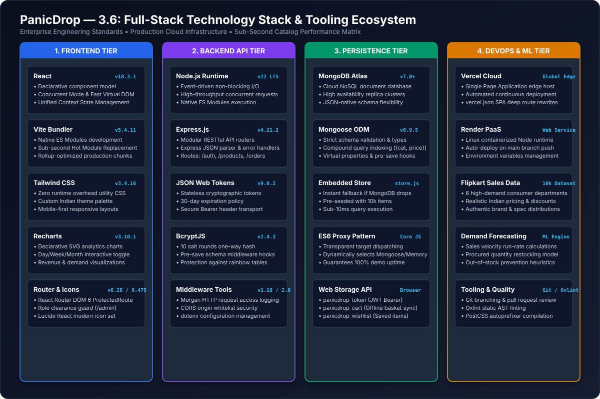

### 7.1 Tech Stack Architecture Diagram

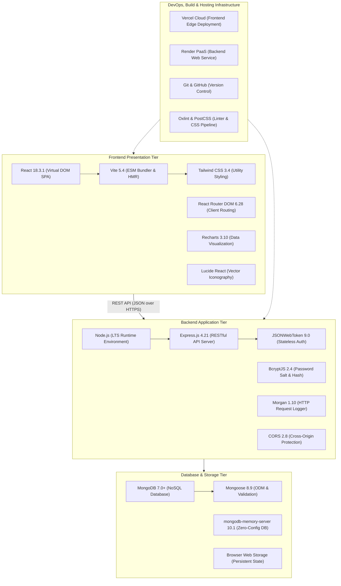

### 7.2 Technology Matrix & Justification

| Technology | Layer | Version | Architectural Justification |
| :--- | :--- | :---: | :--- |
| **React** | Frontend | `18.3.1` | Component-based UI with declarative state updates, Concurrent Mode rendering, and unified Context API for cart/auth state. |
| **Vite** | Build Tool | `5.4.11` | Sub-second Hot Module Replacement (HMR) and optimized Rollup-based production chunking. |
| **Tailwind CSS** | Styling | `3.4.16` | Utility-first CSS framework ensuring responsive, purgeable layouts with zero runtime overhead. |
| **Recharts** | Analytics | `3.10.1` | SVG-based, composable chart library used for interactive daily, weekly, and monthly sales graphs. |
| **React Router** | Navigation | `6.28.0` | Client-side routing with `ProtectedRoute` guards for role clearance and redirect handling. |
| **Node.js** | Runtime | `LTS` | Non-blocking, event-driven I/O ideal for concurrent e-commerce requests and catalog searches. |
| **Express.js** | Backend API | `4.21.2` | Lightweight, modular web framework providing route modularization and custom middleware pipelines. |
| **MongoDB / Mongoose**| Database | `8.9.5` | Flexible JSON-like document model matching dynamic product attributes, reviews, and addresses. |
| **In-Memory Store** | Persistence | Custom | ES6 Proxy layer over memory arrays guaranteeing offline dev speed and high demo reliability. |
| **BcryptJS** | Security | `2.4.3` | Cryptographic hashing algorithm with 10 salt rounds protecting user passwords against rainbow tables. |
| **JSON Web Token** | Auth | `9.0.2` | Compact, stateless authentication tokens eliminating server-side session memory constraints. |
| **Lucide React** | Icons | `0.475.0` | Clean, modern vector iconography covering e-commerce carts, trucks, shields, and rating stars. |

### 7.3 Tooling & Infrastructure

- **Vercel**: Edge-based SPA deployment supporting deep routing via `vercel.json` rewrites (`{ "source": "/(.*)", "destination": "/" }`).
- **Render**: Managed PaaS environment hosting the Node.js API with automated zero-downtime Git deployments.
- **Flipkart Retail Dataset**: Pre-processed catalog foundation containing realistic pricing, MRP ratios, brands, and technical specifications.

---

## 8. Section 3.7: API & Component Design

This section details the internal component structure of the React frontend, the Context state flows, and the RESTful backend API specifications.

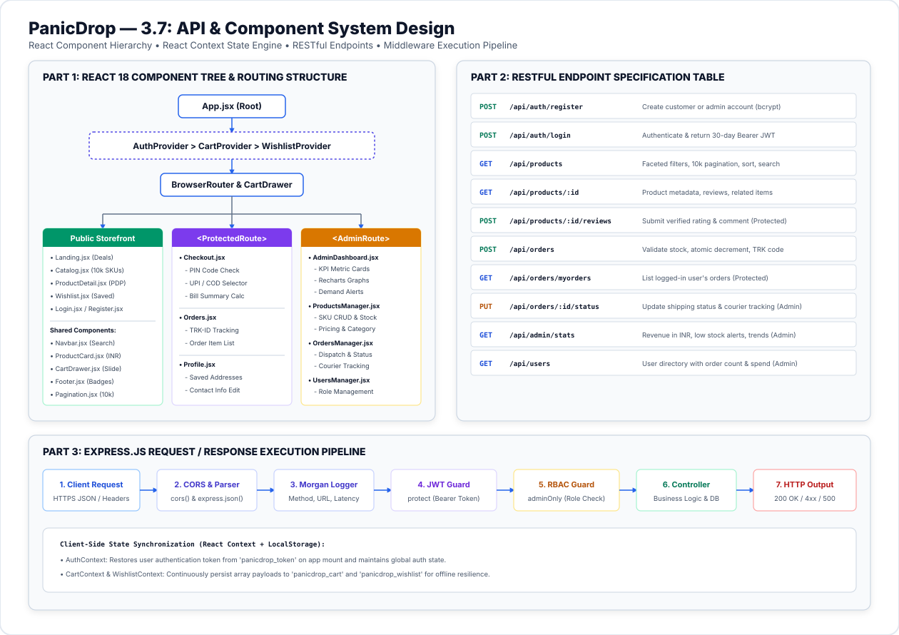

### 8.1 Frontend Component Hierarchy

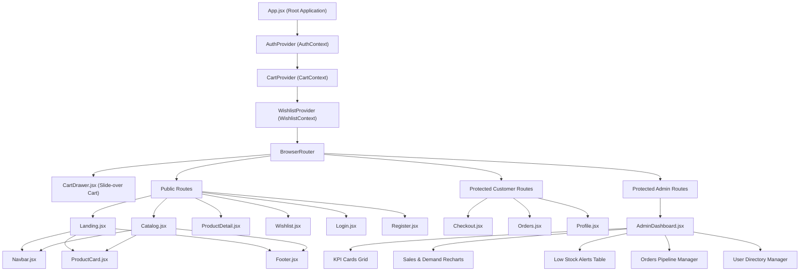

### 8.2 Client State Management Architecture

PanicDrop coordinates client state through three dedicated React Context providers with automated browser `localStorage` synchronization:

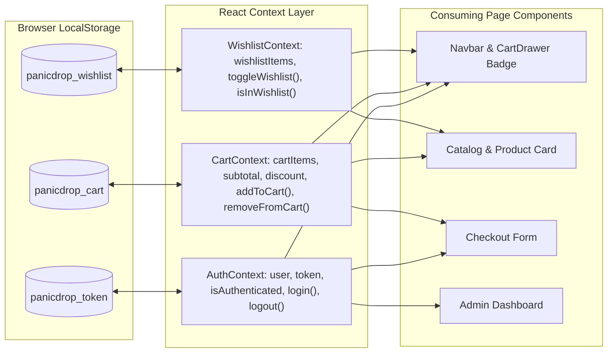

---

### 8.3 Backend RESTful API Endpoint Reference

#### 8.3.1 Authentication Endpoints (`/api/auth`)
| Method | Endpoint | Access Level | Request Payload | Response Format | Purpose |
| :--- | :--- | :---: | :--- | :--- | :--- |
| `POST` | `/api/auth/register` | Public | `{ name, email, password, role? }` | `{ success, user, token }` | Register new customer or admin |
| `POST` | `/api/auth/login` | Public | `{ email, password }` | `{ success, user, token }` | Verify credentials & issue JWT |
| `GET` | `/api/auth/me` | Protected | None (Bearer Token) | `{ success, user }` | Fetch authenticated user profile |
| `PUT` | `/api/auth/profile` | Protected | `{ name, phone, address, avatar }` | `{ success, user }` | Update personal profile data |

#### 8.3.2 Product Catalog Endpoints (`/api/products`)
| Method | Endpoint | Access Level | Query / Body Parameters | Response Format | Purpose |
| :--- | :--- | :---: | :--- | :--- | :--- |
| `GET` | `/api/products` | Public | `search, category, brand, minPrice, maxPrice, minRating, inStock, sort, page, limit` | `{ success, count, total, totalPages, currentPage, products }` | Filter, search, and paginate products |
| `GET` | `/api/products/:id` | Public | URL Param: `id` | `{ success, product, relatedProducts }` | Retrieve product details by ID |
| `GET` | `/api/products/categories/all` | Public | None | `{ success, categories }` | Fetch all unique categories & counts |
| `POST` | `/api/products` | Admin Only | Full product object (name, price, stock, category, images, specs) | `{ success, product }` | Create new catalog item |
| `PUT` | `/api/products/:id` | Admin Only | Fields to update (e.g. stock, price) | `{ success, product }` | Modify product or replenish stock |
| `DELETE`| `/api/products/:id` | Admin Only | URL Param: `id` | `{ success, message }` | Soft/Hard delete product SKU |
| `POST` | `/api/products/:id/reviews` | Protected | `{ rating, comment }` | `{ success, product }` | Add verified user review |

#### 8.3.3 Order Management Endpoints (`/api/orders`)
| Method | Endpoint | Access Level | Request Payload | Response Format | Purpose |
| :--- | :--- | :---: | :--- | :--- | :--- |
| `POST` | `/api/orders` | Protected | `{ orderItems, shippingAddress, paymentMethod, itemsPrice, taxPrice, totalAmount }` | `{ success, order }` | Place order & decrement inventory |
| `GET` | `/api/orders/myorders` | Protected | None (Bearer Token) | `{ success, orders }` | Customer's personal order history |
| `GET` | `/api/orders/:id` | Protected | URL Param: `id` | `{ success, order }` | Retrieve specific order details |
| `GET` | `/api/orders` | Admin Only | `page, limit, status` | `{ success, orders, total }` | Admin view of all customer orders |
| `PUT` | `/api/orders/:id/status` | Admin Only | `{ status, trackingNumber }` | `{ success, order }` | Update order status & courier code |

#### 8.3.4 Administration & User Directory Endpoints (`/api/admin`, `/api/users`)
| Method | Endpoint | Access Level | Parameters | Response Format | Purpose |
| :--- | :--- | :---: | :--- | :--- | :--- |
| `GET` | `/api/admin/stats` | Admin Only | None | `{ success, stats: { totalRevenue, totalOrders, outOfStockCount, lowStockProducts, monthlySales, categorySales } }` | Real-time business KPI analytics |
| `GET` | `/api/users` | Admin Only | `search, role` | `{ success, users }` | List registered users with spend |
| `PUT` | `/api/users/:id` | Admin Only | `{ role, isActive }` | `{ success, user }` | Promote/demote or toggle access |
| `DELETE`| `/api/users/:id` | Admin Only | URL Param: `id` | `{ success, message }` | Remove user record from directory |

---

### 8.4 Express Request Middleware Pipeline

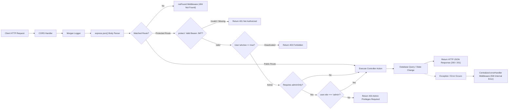

---

## 9. Conclusion

The architectural, workflow, and data specifications documented above represent the operational structure of **PanicDrop**. By combining a decoupled React/Node.js architecture, high-performance in-memory indexing, dual-mode database persistence, and an Indian-centric checkout workflow, PanicDrop provides a resilient, enterprise-ready foundation for large-scale e-commerce and predictive inventory fulfillment.

